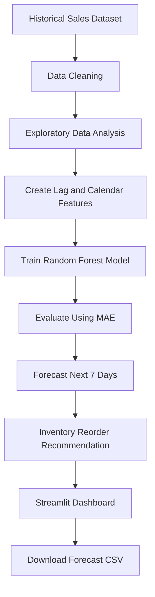

# 📦 SmartStock AI — Demand Forecasting & Inventory Optimization

SmartStock AI is a machine learning project that forecasts product demand using historical sales data and provides inventory replenishment recommendations through an interactive Streamlit dashboard.

## 🎯 Project Objectives

- Analyze historical retail sales trends.
- Forecast demand for the next seven days.
- Evaluate predictions using Mean Absolute Error (MAE).
- Estimate reorder points using predicted demand, supplier lead time, and safety stock.
- Visualize insights through an interactive dashboard.
- Export demand forecasts as CSV files.

## 🛠️ Technology Stack

- **Language:** Python
- **Data Analysis:** Pandas, NumPy
- **Machine Learning:** Scikit-learn, Random Forest Regressor
- **Visualization:** Plotly
- **Web Application:** Streamlit
- **Model Storage:** Joblib

## 📊 Dataset

The project uses the Store Item Demand Forecasting Challenge dataset from Kaggle.

Dataset: https://www.kaggle.com/competitions/demand-forecasting-kernels-only/data

The dataset includes:
- `date` — Date of the sales record
- `store` — Store identifier
- `item` — Product identifier
- `sales` — Units sold

## ⚙️ Project Workflow



## 🚀 Run Locally

1. Clone this repository:

   ```bash
   git clone https://github.com/Meemansha2005/smartstock-ai.git
   cd smartstock-ai
   ```

2. Create and activate a virtual environment:

   ```bash
   python -m venv .venv
   ```

   Windows PowerShell:

   ```powershell
   .venv\Scripts\Activate.ps1
   ```

3. Install dependencies:

   ```bash
   pip install -r requirements.txt
   ```

4. Download the dataset from Kaggle and place `train.csv` inside the `data` folder.

5. Train the model:

   ```bash
   python train_model.py
   ```

6. Start the dashboard:

   ```bash
   streamlit run app.py
   ```

## 📈 Model Evaluation

The Random Forest model is evaluated on a held-out chronological test period using Mean Absolute Error (MAE). Its performance is compared with a previous-day sales baseline.

Lower MAE indicates smaller average absolute prediction errors. Actual evaluation values are generated when the training script runs.

## 📦 Inventory Recommendation

The application estimates:

- **Lead-time demand:** Average forecast demand multiplied by supplier lead time.
- **Reorder point:** Lead-time demand plus safety stock.
- **Suggested order quantity:** The quantity needed to reach the estimated target stock level.

These recommendations are estimates and depend on the accuracy of the forecast and the inventory inputs supplied by the user.

## ⚠️ Limitations

- Forecast accuracy depends on historical sales patterns.
- Inventory recommendations use user-provided lead time and safety stock.
- The dataset does not include actual inventory levels or supplier information.
- This project is an academic prototype, not a production inventory management system.

## 🔮 Future Improvements

- Compare multiple forecasting algorithms.
- Support user-uploaded sales datasets.
- Incorporate holidays, promotions, and seasonal patterns.
- Add more robust inventory optimization.
- Deploy the application online.

## 👩‍💻 Author

**Meemansha Pandey**

B.Tech Honours — Data Science

GitHub: https://github.com/Meemansha2005
